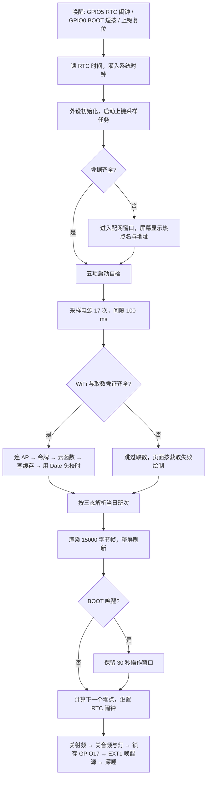

# 00 · 项目总览

- **工程**：`D:\zectrix\zectrix_yike`，ESP-IDF 工程名 `zectrix_calendar`
- **设备**：Zectrix Note 4（ESP32-S3 N16R8 · 4.2" 400×300 黑白墨水屏）
- **功能**：每天 00:00 自动唤醒，刷新一页台历 —— 年月日、农历、星期、节气、节日、当日班次与两段时段、电量与 WiFi 信号；刷新后进入深度休眠
- **整理日期**：2026-10-26

本文是**入口与索引**：版式坐标、接口字段、按键行为在这里给出可直接使用的结论，细节与推导过程留在各专题文档，避免同一事实记两份。改版式仍以 `tools/calendar_A_final.py` 为准，改接口仍以 `docs/11` 为准。

---

## 1 硬件与设备基线

| 项 | 值 |
|---|---|
| SoC | ESP32-S3 **N16R8**：16 MB Flash / 8 MB PSRAM，**没有双精度 FPU** |
| 屏幕 | 4.2" **400×300** 黑白，SSD2683，1bpp、MSB-first、**0 = 黑 / 1 = 白**，整帧 **15000 字节** |
| 墨水屏引脚 | SPI3：DC=10、CS=11、SCLK=12、MOSI=13、RST=9、BUSY=8、PWR=6，20 MHz |
| 实时时钟 | PCF8563，I²C 地址 `0x51`，中断 `GPIO5`，可作深度休眠唤醒源；读取时检查 VL 标志判断是否断过电 |
| 电池 | 2000+ mAh 锂聚合物，Type-C 充电；`GPIO17` 电池供电锁存；`GPIO2/1` 充电检测；可换电芯上限 75×50×5 mm |
| 按键 | 正面 BOOT `GPIO0`、侧边上键 `GPIO39`、侧边下键 `GPIO18`、针孔 RESET |
| 其他外设 | NFC `0x55`、ES8311 音频编解码、状态灯 |
| 串口 | **COM5**，USB-Serial/JTAG，`VID:PID = 303A:1001`，烧录波特率 **921600** |
| 设备 MAC | `<device-mac>` |

引脚唯一真源是 `firmware/components/zectrix_board/include/zectrix_board_config.h`。`firmware/docs/HARDWARE.md` 内容不全，漏掉墨水屏引脚与电池 ADC。

---

## 2 工程结构与代码分布

`firmware/` 是从官方 Demo fork 的只读副本，只通过 `EXTRA_COMPONENT_DIRS` 引用。业务代码全部在 `app/`。

| 组件 | 职责 | 关键文件 | 依赖 |
|---|---|---|---|
| `main` | 主流程：唤醒判定、自检、取数、校时、渲染、刷屏、闹钟、休眠 | `app/main/app_main.cc`（959 行） | 全部业务组件 + `zectrix_board` / `zectrix_epd` |
| `cal_almanac` | 农历 / 节气 / 节日，纯 C99、零 IDF 依赖 | `cal_almanac.c`、`cal_lunar_table.c` | 无 |
| `cal_font` | 点阵字库：25 组字号、1333 字形、74.4 KB | `cal_font.cc`、`cal_font_data.c` | `log` |
| `cal_render` | 台历页绘制，纯 C + 少量 C++，零 IDF 依赖 | `cal_render.cc` | `cal_font`、`cal_almanac` |
| `cal_net` | WiFi 连接、凭据存取、串口与网页配网 | `cal_wifi.cc`、`cal_cred.cc`、`cal_provision.cc` | `nvs_flash`、`esp_wifi`、`esp_event`、`esp_netif` |
| `cal_sched` | OAuth + 云函数两步调用、响应解析、缓存、`Date` 头换算 | `cal_sched_parse.c`、`cal_sched_http.cc`、`cal_sched_store.cc` | `esp_http_client`、`json`、`mbedtls` |

`cal_almanac`、`cal_sched_parse.c`、`cal_render` 三个组件**刻意不引入任何 IDF 头**：同一份源码会在 PC 上用宿主编译器再编一遍，与 Python 参照实现做逐项或逐像素比对。

分区表（`app/partitions.csv`）：`nvs` @ `0x9000` 24 KB、`phy_init` @ `0xf000` 4 KB、`factory` @ `0x10000` 3 MB。刷入会替换原厂分区表与 bootloader，`backup/` 里的 16 MiB 全量镜像备份是唯一退路。

---

## 3 一次唤醒的完整流程



各阶段的关键约束：

| 阶段 | 约束 |
|---|---|
| 系统时钟 | 必须先把 RTC 时间灌进系统时钟。系统时间停在 1970 时，mbedTLS 校验证书有效期会失败，报错看起来像证书问题 |
| 自检 | 历法 6 例、字体 10 例、渲染 9 例、排班 6 例，全部在启动时跑，任一 mismatch 立刻暴露 |
| 电源采样 | 连续读取 17 次（含 16 次 100 ms 间隔），覆盖充电检测引脚稳定时间；ADC 无效直接终止流程 |
| 取数 | 失败间隔 60 秒重试，最多 3 轮；WiFi 关联失败直接进下一轮，不额外等待 |
| 刷屏 | 刷屏或设置闹钟期间跨过零点时，立即按新日期重画，不带着旧日期入睡 |
| 休眠 | 顺序固定：关射频 → 关音频 → 关灯 → NFC 断电 → `rtc_gpio_hold_en(GPIO17)` → EXT1 唤醒源 → `esp_deep_sleep_start()` |

---

## 4 页面布局

### 4.1 区域划分

| 区域 | 横向范围 | 纵向范围 | 内容 |
|---|---|---|---|
| 顶栏左 | `x=16` 起 | `y=30` 为中心 | 年月日，pt28 |
| 顶栏右 | 右对齐 `x=384` | 农历 `cy=30`，节日签 `cy=38` | 农历 pt21 / pt18，节日反白签 pt18 |
| 顶栏分隔线 | 全宽 | `y=52` | 1 px |
| 主区左 | `x=16` 起 | 中心 `y=147` | 两段时段 pt24–25，或「休息」pt72，或「获取失败」pt30 |
| 主区分隔竖线 | `x=232` | `y=62..232`，粗 2 | — |
| 主区右 | 星期列 `cx=316`，节气列 `cx=367` | 首字中心 `y=104` | 竖排星期 pt44，竖排节气 pt31 |
| 电量与信号 | `x=275..383`，`y=62..77` | 星期文字上方 | 电池图标 + 百分比 + 四格信号 |
| 底栏 | `x=16` 起 | `cy=266` | 标签「今日班次」pt23 + 班次反白块 pt28 |

### 4.2 坐标表（400×300 真实像素）

| 元素 | 位置与尺寸 | 字号 |
|---|---|---|
| 年月日 | 左锚 `x=16`、`y=30` | pt28 |
| 农历（无节日） | 右对齐 `x=384`、`cy=30` | pt21 |
| 农历（有节日） | 右对齐 `x=384`、`cy=17` | pt18 |
| 节日反白签 | 右对齐，签高固定 26，内边距 10，间隙 14 | pt18 |
| 时段两行 | 左锚 `x=16`，行心距 60，整块中心 `y=147` | pt24–25 自动收缩 |
| 「休息」 | 左栏居中 `cx=118`、`cy=147` | pt72 |
| 「获取失败」 | 同上位置 | pt30 |
| 竖排星期 | 列中心 `x=316`，首字中心 `y=104`，字距 52 | pt44 |
| 竖排节气 | 列中心 `x=367`，块中心 `y=156`，字距 46 | pt31 |
| 「今日班次」 | 左锚 `x=16`、`cy=266` | pt23 |
| 班次反白块 | 中心基准 `x=320`（过宽平移）、`cy=266`、块高固定 52、宽度 64–276 | pt28，超宽降到 20 |
| 电量百分比 | 右边缘 `x=384`、垂直中心 `y=70` | pt18 |
| 电池主体 | 20×12，触点 2×4，与文字间隔 6 | — |
| 信号四格 | 22×13，竖条宽 4、间隔 2，高度 4/7/10/13，底边与电池底部齐平 | — |

### 4.3 字号层级与字体

```
常规：星期 44 > 节气 31 > 班次名 28 = 年月日 28 > 时段 25
      > 底栏标签 23 > 农历 21 > 农历（有节日时）18 = 节日签 18
休息日：「休息」72，当天主区唯一元素
失败态：「获取失败」30，占时段两行的位置
```

墨水屏只有黑白两色，层次只能靠字号与反白拉开。反白（黑底白字）只用在节日签与班次块两处。

字体是 Noto Sans SC 可变字体（SIL OFL 1.1），必须经 `load_font()` 取用，内部执行 `set_variation_by_axes([700])` 得到 Bold。这份字体默认实例是极细的 Thin，直接用 `ImageFont.truetype()` 会把笔画渲染断开。选择 OFL 授权的字体是因为把字形渲染成点阵嵌进固件属于字体的复制与嵌入行为，商用字体需要额外授权。

### 4.4 五种画面状态

| 状态 | 触发条件 | 主区左栏 | 底栏班次块 |
|---|---|---|---|
| 正常 | 当天有班次与时段 | 两段时段，前缀按开始时间取「凌晨 / 上午 / 下午 / 夜间」 | 画 |
| 休息日 | 班次名含「休」 | 「休息」pt72，时段两行完全不画 | 画「休」 |
| 该天无排班 | 服务端省略 `shiftName` 键，`blank_schedule=true` | 整栏留白 | 不画 |
| 拉取失败 | 无响应、业务码非 200、解析失败，且本地无该天缓存 | 「获取失败」pt30 | 不画 |
| 配网提示 | 缺 WiFi 或取数凭证 | 三行提示：说明、热点名 `Zectrix-Cal-XXXX`、地址 `192.168.4.1` | 整页不画台历 |

「该天无排班」与「拉取失败」都表现为内容为空，判据由取数层给出的 `blank_schedule` 决定，渲染器不自行猜测。把未排班日画成「获取失败」会把正常业务结果报成故障。

### 4.5 电量与信号格

| 状态 | 显示 |
|---|---|
| 正常 | 电池按电量填充，百分比向下取 5% 的整数倍 |
| 低电量 | 原始估算低于 20%，电池左侧加静态感叹号 |
| 充电 | 电池内部静态闪电，百分比仍按 5% 步进 |
| 充满 | 满格电池与 100% |
| 未装电池 / 充电故障 | 空电池、感叹号、`--%` |
| WiFi 已连接 | 按 RSSI 分档点亮：≥ -55 四根、≥ -65 三根、≥ -75 两根、更弱一根，至少亮一根 |
| WiFi 未连接 | 四根竖条都不画，改画两条交叉斜线占满区域 |

4 像素宽的竖条画不出 2 像素边框的空心，空心会退化成实心，所以断开态换形状。信号格在电池左侧，右边缘距电池 10 像素，这 10 像素同时留给低电量感叹号（占 7 像素，留 3 像素空隙）。

电量只在页面刷新时更新，深度休眠期间保持最后一次读数。

### 4.6 版式规则

1. 节气有则显示、无则不占位，星期列位置恒定不受影响。
2. 清明让位：`节气名 in 节日名` 时不显示节气，避免同一天两处重复。
3. 同日多个节日全部并排，每个节日一个独立反白签，整行右对齐，按重要度降序从左到右。1900–2099 共 69 天撞车，全部是两个节日。
4. 休息日不画时段，主区换「休息」大字。
5. 空内容不留空壳：班次名为空不画反白块，两段时段都空不画前缀。
6. 多节日签放不下时先缩内边距、后缩字号，档位 `(18,10,14) → (18,9,13) → (18,8,12) → (17,8,12) → (16,7,11) → (15,6,10) → (14,6,9)`。全部档位都放不下才合并成一个签。

**逐字绘制与同屏并列的元素必须固定 pt。** 按墨迹高度选字号在三类内容上都是错的：数字墨迹只占 em 的 71%，`9DP1` 会被选到 pt44 撑爆底栏；「一」的墨迹高度其实是笔画厚度，要「墨迹高 40」会选到 pt95；汉字墨迹高相差 1 px 会让同一天的两个节日签字号不一致。这个错误在项目里踩过 4 次。

---

## 5 接口调用

本节请求地址与字段中的尖括号（`<client-id>`、`<project-id>`、`<product-id>`、`<api-key>`、`<group-id>`）是脱敏占位符，真实值保存在 `tools/agc_probe.py` 与设备 NVS 中。

### 5.1 链路


设备侧没有自建服务器。中转与鉴权都在华为 AGC 上完成，设备只认 AGC 网关的两个地址。原始班次数据源的凭据放在云函数环境变量里，不下发到设备。

### 5.2 OAuth 请求

```http
POST https://connect-drcn.dbankcloud.cn/agc/apigw/oauth2/v1/token
Content-Type: application/json
```

```json
{"grant_type": "client_credentials", "client_id": "<client-id>", "client_secret": "<client-secret>", "useJwt": 0}
```

| 项 | 值 |
|---|---|
| 成功判据 | HTTP 200、合法 JSON、`access_token` 非空 |
| 响应字段 | `access_token`（实测 227 字符）、`expires_in`（实测 175480 / 176413 秒，约 48.7 小时） |
| `useJwt` | JSON 数字 `0`，注意字段大小写 |
| 耗时 | 实测 112 ms（PC）/ 1722 ms（设备首次） |

### 5.3 云函数请求

```http
POST https://connect-drcn.dbankcloud.cn/agc/apigw/wisefunction/functions/<project-id>/proxy-function-$latest
clientId: <client-id>
Authorization: Bearer <access_token>
productId: <product-id>
Content-Type: application/json
```

```json
{"apiKey": "<api-key>", "data": {"groupId": "<group-id>", "startDate": "2026-10-22"}}
```

| 项 | 值 |
|---|---|
| `clientId` | AGC Client ID，与 OAuth 的 `client_id` 相同 |
| `productId` | 网关路由头，随接口地址写进代码，不属于密钥 |
| `apiKey` | 业务密钥，在**请求体**里，不在请求头 |
| `startDate` | `YYYY-MM-DD`，取 RTC 当天日期，服务端返回 14 天 |
| 成功判据 | HTTP 200 且响应体 `code == 200` |
| 响应体上限 | 4096 字节，超出判失败。截断会让 JSON 断在记录中间，看起来像少了一天 |
| 证书校验 | `esp_crt_bundle_attach`，不跳过 |

### 5.4 字段映射

云函数返回的字段与固件内部结构：

| 云函数字段 | 固件 `CalSchedDay` | 说明 |
|---|---|---|
| `date` | `year/month/day` | 严格 10 字符 `YYYY-MM-DD` |
| `shiftName` | `shift` | 原始串，全角括号由渲染器归一化；键存在即 `has_schedule=true` |
| `amStart` + `amEnd` | `am` | 拼成 `HH:MM-HH:MM` |
| `pmStart` + `pmEnd` | `pm` | 拼成 `HH:MM-HH:MM` |
| `remark` | 不使用 | — |

**字段缺省表示该天没有排班。** 服务端不发空字符串、不发 `null`，直接省略键。判据是「`shiftName` 键是否存在」，不是值是否为空。判据分两层：`code == 200` 判调用成功，`shiftName` 键是否存在判某天有没有排班。

休息日的 `amStart`/`pmStart` 服务端给的是 `00:00`，解析阶段直接丢弃。照抄会画出「凌晨00:00-00:00」。

### 5.5 三态判定

| 缓存里有今天 | 今天的 `shiftName` | 页面 |
|---|---|---|
| 有 | 存在 | 正常显示班次与两段时段 |
| 有 | 被省略 | 主区留白、底栏不画班次块 |
| 无 | — | 主区「获取失败」、底栏不画块 |

### 5.6 令牌复用与重试

`expires_in` 接近 49 小时，设备每天只醒一次。每次唤醒都换令牌等于把一次 TLS 握手变成两次，唤醒时长与耗电都翻倍。

| 情形 | 动作 |
|---|---|
| 过期时刻 − 3600 秒 > 当前时间 | 直接用缓存令牌，跳过 OAuth |
| 已过期或无缓存 | 换新令牌并写回 NVS |
| 云函数返回 401 | 清缓存令牌 → 换新 → 重试一次 |
| 配网重写凭证 | 一并清掉令牌 |
| 取数失败 | 间隔 60 秒重试，最多 3 轮 |
| WiFi 关联失败 | 直接进下一轮，不额外等待 |

令牌与绝对过期时刻存 NVS `cal_agc` 的 `token` 与 `expire`。1 小时余量吸收两类边界：本地时钟刚校准，以及请求在路上的往返时间。

### 5.7 校时

校时来源是云函数响应头的 `Date`，零额外请求。解析 RFC 1123 → UTC 秒 → 加 8 小时得北京时间 → 与 RTC 比较，**差异超过 5 秒才写**。RTC 每天误差约 1.7 秒，一天写一次足够。

`esp_http_client_get_header(client, "Date", …)` **取不到这个头**，实测返回空值。必须挂 `config.event_handler`，在 `HTTP_EVENT_ON_HEADER` 回调里认 `header_key == "Date"`。这个坑的症状很隐蔽：链路全程 HTTP 200、数据全对，只有日志里一句「Date 头不可用」。

校时可能把日期改到次日，出页用的日期以校时后的值为准，取数不重跑。

### 5.8 实测指标（2026-10-26 真机）

| 项 | 值 |
|---|---|
| 配网写凭证 | `PROV {"ok":true,"agcComplete":true}` |
| OAuth | HTTP 200，1722 ms，令牌 227 字符 |
| 云函数 | HTTP 200，2126–5066 ms，响应 1136 字节，14 天 |
| 取数总耗时 | 首次 8710 ms；复用令牌 4105 ms |
| Date 校时 | 首次偏差 56 秒；随后 0–1 秒不写 |
| WiFi 关联 | 1668 ms，-51 dBm |
| 页面 | `班次 B1 [09:30-13:15] [17:00-21:00]` |
| 应用镜像 | 1 262 240 字节，app 分区剩余 60% |

---

## 6 设备按键与交互

| 按键 | 操作 | 行为 |
|---|---|---|
| BOOT `GPIO0` | 深度休眠时短按 | EXT1 唤醒，刷新当天页面，保留 30 秒操作窗口 |
| BOOT `GPIO0` | 配网窗口内短按（< 500 ms） | 退出配网并重启，凭据已在 NVS，重启后直接显示台历页 |
| 上键 `GPIO39` | 醒来期间按住 3 秒（3–8 秒之间）松开 | `esp_restart()`，重新绘制页面并设置下一个零点闹钟 |
| 上键 `GPIO39` | 一直按住到 8 秒 | 置 RTC 内存魔数后重启，进入配网模式，不必松开 |
| 上键 `GPIO39` | 短按 | 无动作 |
| 下键 `GPIO18` | 短按或长按 | **没有配置业务操作。** 原厂固件里它是电源键，长按 3 秒执行真断电，业务固件不接管 |
| RESET | 按下 | 硬件复位 |
| BOOT + RESET | 按住 BOOT 再按 RESET，随后松开 BOOT | 进入 ROM 下载模式 |
| 操作窗口中持续按住 BOOT 或上键 | — | 操作窗口延长到松开后的 30 秒 |

关键常量（`app/main/app_main.cc`）：

| 常量 | 值 | 含义 |
|---|---|---|
| `kButtonAwakeMs` | 30000 | 按键唤醒后的操作窗口 |
| `kBootTapMs` | 500 | BOOT 短按判定上限 |
| `kProvisionHoldMs` | 8000 | 上键进配网的长按时长 |
| `kProvisionIdleMs` | 300000 | 配网窗口闲置退出时间，另有 900 秒硬上限 |

配网期间想退出就短按 BOOT。上键那条 3 秒判定要走去抖流程，按下与松手各有 40 ms 采样延迟，按「数到 3 秒」常常差几十毫秒落在阈值下方，再按久一点又会撞上 8 秒分支，重启后仍停在配网页。

**不做真关机。** 原厂长按下键 3 秒执行 `Shutdown()`，拉低 `GPIO17` 断掉电池供电轨，整机无电，RTC 与按键都唤不醒，当天不会自动刷新。省电统一由深度休眠承担。

唤醒源只有两个：`GPIO5`（RTC 闹钟）与 `GPIO0`（BOOT），同为低电平 EXT1 唤醒。上键 `GPIO39` 只在芯片醒来后生效。

---

## 7 配网与凭据存放

设备只有两个按键与一块 400×300 单色屏，逐字符输入 8 位以上密码或 64 位十六进制密钥不成立，凭据只能从外部写入。两条通道：USB 串口与手机网页，可只写其中一块，留空字段保持 NVS 原值。

| 凭据 | NVS 命名空间 | 键名 | 长度上限 |
|---|---|---|---|
| WiFi | `cal_net` | `ssid`、`pass` | 32 / 64 字节 |
| 取数凭证 | `cal_agc` | `clientid`、`secret`、`apikey`、`groupid` | 40 / 80 / 64 / 40 |
| 令牌缓存 | `cal_agc` | `token`、`expire` | 换凭证时清除 |
| 班次缓存 | `cal_sched` | `days` | 1108 字节 blob，14 条 |

串口协议（单行 JSON，`\n` 结尾，上限 255 字节）：

```json
{"wifi":{"ssid":"MyWiFi","pass":"12345678"}}
{"agc":{"clientId":"...","secret":"...","apiKey":"...","groupId":"..."}}
```

回执用 `PROV ` 前缀与日志区分：

```json
PROV {"ok":true,"ssid":"MyWiFi","ip":"192.168.1.7","rssi":-51,"ms":1842,"agcComplete":true}
PROV {"ok":false,"stage":"connect","error":"association failed","agcComplete":false}
```

| `stage` | 含义 |
|---|---|
| `parse` | 输入格式错误 |
| `credential` | 取数凭证写入失败 |
| `save` | WiFi 凭据写入失败 |
| `connect` | 关联失败，回执带 `reason` 码 |

网页配网：手机连接热点 `Zectrix-Cal-XXXX`，浏览器访问 `http://192.168.4.1`。热点开放，只在配网窗口内存在。不做 DNS 劫持，所以不会自动弹出强制门户，需要手动输入地址。

进配网的条件：缺 WiFi 凭据、缺取数凭证、两类都缺、或上键按到 8 秒主动触发。主动触发通过 RTC 内存的魔数 `0x50524F56` 传递意图，软件复位不清这块内存，上电复位内容不确定，启动时必须校验魔数并立刻清零。

WiFi 驱动必须设 `esp_wifi_set_storage(WIFI_STORAGE_RAM)`。默认的 `WIFI_STORAGE_FLASH` 会让 `esp_wifi_set_config()` 另写一份到 `nvs.net80211`，同一份凭据存两处，改一处另一处仍是旧值。

凭据是明文。项目红线是不烧 eFuse，Flash Encryption 与基于 eFuse 的 NVS 加密都不可用，`esptool read_flash` 能读到明文。风险靠权限边界控制：AGC 应用身份只具备调用本中转函数的权限，原始数据源凭据留在云函数环境变量里。日志只打印 Client ID 与分组编号。

---

## 8 构建、烧录与验证

```powershell
# 构建（必须走项目包装器，别直接调 idf.py）
tools/.venv/Scripts/python.exe tools/idf.py -C app -DCALENDAR_RTC_CONSOLE=OFF build

# 烧录
tools/.venv/Scripts/python.exe tools/flash_retry.py --port COM5 --baud 921600

# Flash 全量备份 / 校验 / 还原（唯一退路）
tools/.venv/Scripts/python.exe tools/flash_backup.py backup|verify|restore --port COM5 --baud 921600
```

`CALENDAR_RTC_CONSOLE=ON` 是校时与真实闹钟验证入口，通过串口接收 JSON 命令直接设置 PCF8563，正式固件必须关闭。

### 验证工具矩阵

| 对象 | 工具 | 判据 |
|---|---|---|
| 页面渲染 | `tools/cal_render_test.py` | 17 用例全帧 15000 字节逐像素比对 |
| 电量与信号 | `tools/battery_render_test.py` | 全部电源状态 204 次逐像素比对 |
| 顶栏单节日回归 | `tools/regress_top_single.py` | 差异包围盒仅在签行 |
| 历法 | `tools/almanac_test.py` | 209 610 项黄金向量 |
| 字库 | `tools/font_verify.py`、`tools/font_missing_test.py` | 字符级断言、47 项缺字断言 |
| 字库普查 | `tools/pt_census.py --verify` | 形态表双向检查 |
| 日期与按键 | `tools/calendar_clock_test.py` | 36 524 个日期零点计算、按键边界 |
| 排班解析 | `tools/sched_parse_test.py` | 181 项断言，含 6 种违约样本与缓存往返 |
| 接口 | `tools/agc_probe.py` | 真实两步调用 + 契约检查 |
| 串口配网 | `tools/provision.py` | 回执解析 |
| 板端 | 启动自检 | `almanac / font / render / sched self-check: N mismatch`，N 必须为 0 |

板端自检不是重复 PC 侧的测试。ESP32-S3 没有双精度 FPU，`double` 由软件模拟，libm 与 PC 不同源；板端这一层验证的是烧进设备的这份二进制确实产出同一张图。

---

## 9 红线与已知陷阱

| # | 条目 | 后果 |
|---|---|---|
| 1 | 绝不烧 eFuse（Secure Boot / Flash Encryption） | 唯一不可逆操作，无法退回原厂 |
| 2 | 省电只走深度休眠，绝不调原厂 `Shutdown()` | 真断电，当天不再刷新 |
| 3 | `GPIO17` 必须 `rtc_gpio_hold_en(GPIO_NUM_17)` | 数字域掉电导致锁存丢失，供电轨断，等同变砖 |
| 4 | ESP32-S3 没有 `gpio_deep_sleep_hold_en()` | 只能走 RTC pad 锁存 |
| 5 | 逐字绘制与同屏并列固定 pt | 按墨迹高度选字号会让整列宽度不一致 |
| 6 | 改版式只改 `tools/calendar_A_final.py`，再同步 `docs/03` | 两处都改会造成两份真源 |
| 7 | 业务代码放 `app/`，不动 `firmware/` | 同步 upstream 必然冲突 |
| 8 | Windows 上必须用 `tools/idf.py` | Git Bash 被 `MSYSTEM` 硬拒、`IDF_TOOLS_PATH` 激活后丢失、PATH 传不进子进程 |
| 9 | 回归必须走 `load_payload()` 完整链路 | 直接传裸值会漏前缀，全图约 4600 px 假差异 |
| 10 | 睡前必须调 `CalWifiShutdown()`，位置在 `rtc_gpio_hold_en` 之前 | 射频没关就入睡，静态电流从几十微安升到数百微安 |
| 11 | 断言必须到「字」一级 | 用 Pillow 当参照，它什么字都能渲染，必然零差异 |
| 12 | 普查要同时覆盖「量宽」用的 pt | 漏收 pt27 会让最坏签行少降一档，全帧差 880 px |
| 13 | 编译偶发卡死判据：ninja / xtensa-g++ 的 CPU 时间接近 0 且 build 目录 5 分钟无改动 | 属于卡死，停掉重跑，不要干等 |
| 14 | 调宿主 gcc 要把 `D:\development_tools\msys64\ucrt64\bin` 加进子进程 PATH | 否则静默退出，无输出无错误码 |

---

## 10 文档索引

| 文件 | 内容 | 状态 |
|---|---|---|
| `docs/00-项目总览.md` | 本文：入口、硬件、结构、流程、布局、接口、按键、构建、红线 | 当前 |
| `docs/01-首次刷机操作手册.md` | 备份、空转测试、安装环境、构建烧录、回滚 | 当前 |
| `docs/02-环境搭建与踩坑记录.md` | Windows 上 ESP-IDF 的六个坑、工具链清单、日常命令 | 当前 |
| `docs/03-台历页规格与数据契约.md` | **权威版式规格**：坐标、字号、数据契约、字模、决策清单、取数策略与功耗预算 | 当前 |
| `docs/06-第三方接入华为云函数方法.md` | AGC 云函数中转的权限设计参考 | 参考 |
| `docs/07-华为云函数中转接入实施方案.md` | 任务 6 的实施方案（链路、鉴权、验收条件） | 已实施完成，接口细节以 `11` 为准 |
| `docs/08-每日零点刷新验收.md` | 零点唤醒与跨日补刷的软件与设备验证 | 当前 |
| `docs/09-按键操作与验证.md` | 按键行为、边界判定、设备验证记录 | 当前 |
| `docs/10-电量显示与烧录验证.md` | 电量显示的实机验证与镜像信息 | 当前 |
| `docs/11-AGC接口调用说明.md` | **权威接口文档**：请求、响应、固件实现、真机实测 | 当前 |
| `docs/12-WiFi配网与连接.md` | 凭据存放、串口与网页配网、连接流程、失败处置 | 当前 |

交接记录、接口探测快照与维护者自检清单属于开发过程文档，只在本地保留，不随仓库发布。

`tools/calendar_A_lunar.py` 与 `tools/calendar_A_term.py` 是早期选型脚本，只支持单节日，不要再用。
